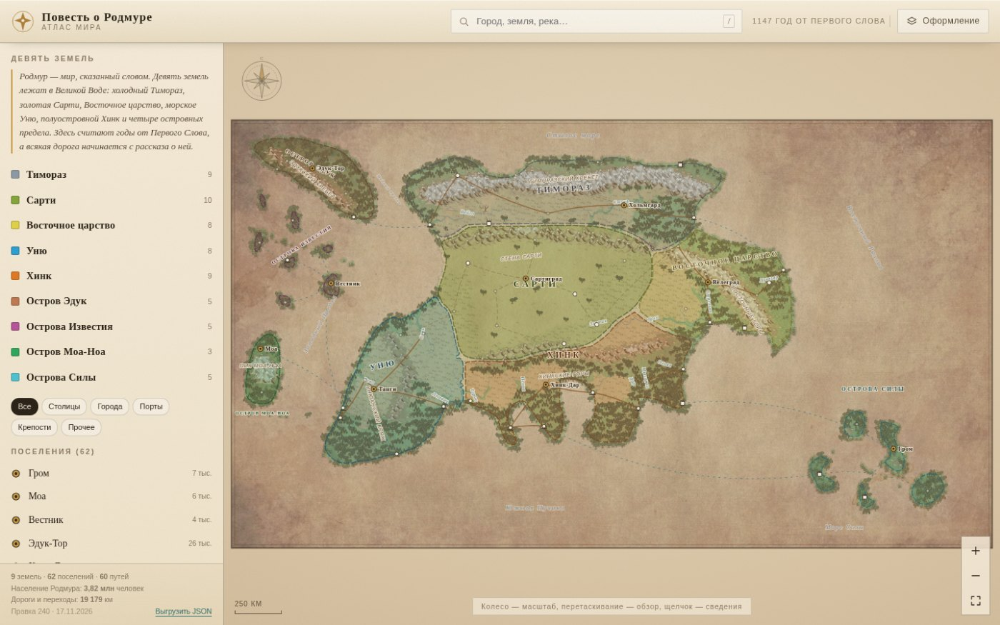
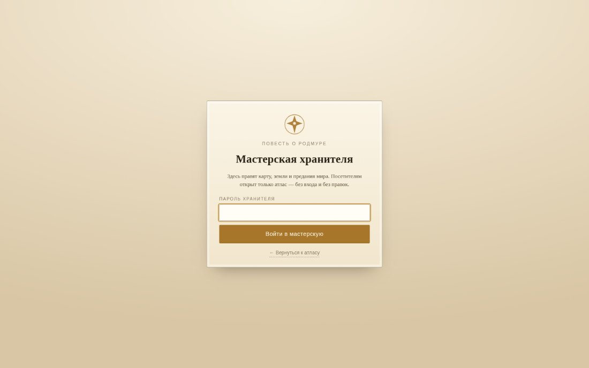
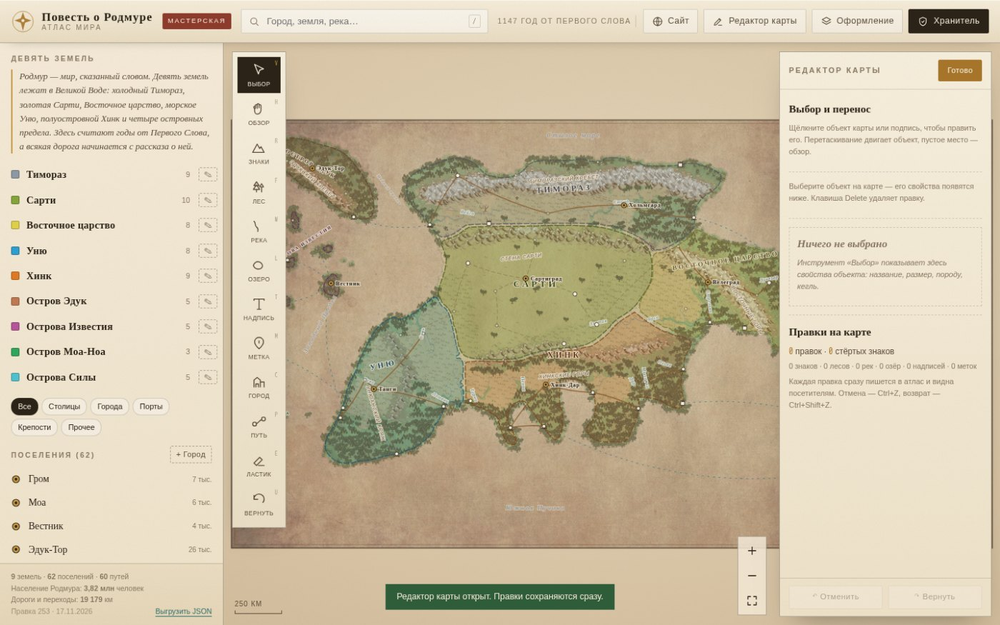
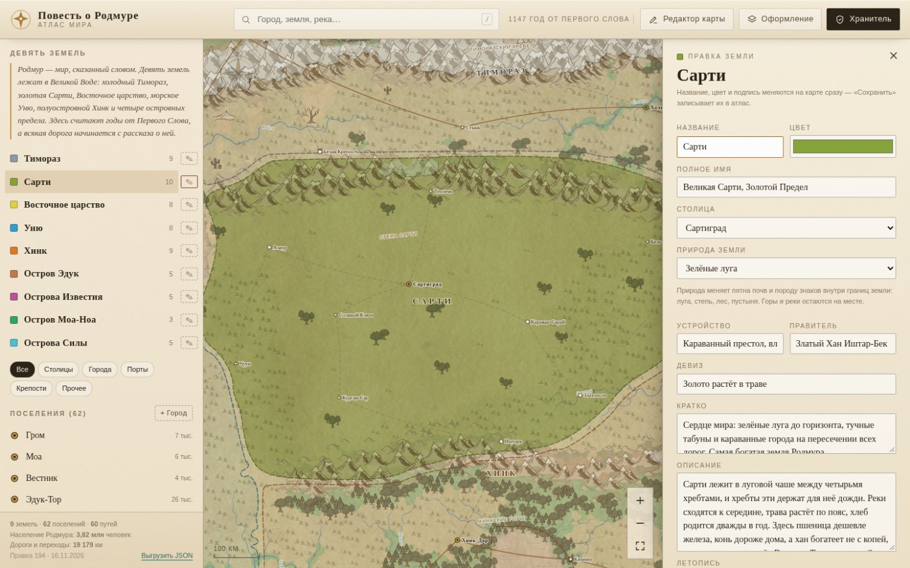

# Повесть о Родмуре — веб-атлас мира

Интерактивная карта мира Родмура для сайта: девять земель, 62 поселения, тракты и морские
переходы, реки, горные хребты и моря. Посетители читают атлас, хранитель мира (вы) правит его
прямо в браузере — без пересборки и без базы данных.



* Подложка — гравированная физическая карта, построенная по авторскому рисунку Родмура.
* Политический слой (земли, города, пути, подписи) — собственный, рисуется поверх подложки.
* Сервер — чистый Node.js без зависимостей: статика + JSON-API + пароль хранителя.
* Данные — один файл `data/world.json` и лента ревизий рядом с ним.

---

## Быстрый старт

Нужен Node.js 20 или новее. Никаких `npm install` для запуска не требуется.

```bash
npm start            # = node server/index.mjs
```

Атлас живёт на двух страницах:

| Адрес | Кому | Что там |
| --- | --- | --- |
| `/` | посетителям | интерактивный атлас только для чтения: карта, поиск, сведения, оформление |
| `/admin` (он же `/map_redactor`) | хранителю | застава с паролем, затем мастерская: редактор карты, правка земель и городов, панель хранителя |

```
  посетители:  http://localhost:8080/
  мастерская:  http://localhost:8080/admin  (он же /map_redactor)
```

При первом запуске сервер создаёт пароль хранителя и печатает его в журнал:

```
  Хранитель: создан пароль pzVuNBI4GjyF
  Он сохранён в data/admin.json в виде хэша. Смените его в панели хранителя.
```

Откройте `/admin`, введите пароль на заставе — и мастерская откроется сразу с верстаком
редактора. Сменить пароль: **«Хранитель» → вкладка «Пароль»**. Выход возвращает к заставе.

Задать пароль заранее можно переменной окружения или файлом `.env` (см. `.env.example`):

```bash
cp .env.example .env
echo "RODMUR_ADMIN_PASSWORD=мой-длинный-пароль" >> .env
npm start
```

> `RODMUR_ADMIN_PASSWORD` применяется при каждом старте и перезаписывает сохранённый хэш.
> Если вы сменили пароль через панель, уберите переменную из `.env`, иначе старый пароль вернётся.

---

## Что умеет посетитель — страница `/`

* Панорама (перетаскивание), масштаб (колесо, щипок, двойной щелчок, кнопки), «весь мир».
* Щелчок по земле или городу — панель сведений: правитель, устройство, население, площадь,
  природа земли, летопись, ремёсла, ратное дело; у города — год основания, высота, порт/река, чем известен,
  все пути с длиной в километрах.
* Поиск по названию, земле и описанию (`/` — фокус в поиск, `Enter` — первый результат).
* Фильтры поселений: столицы, города, порты, крепости, прочее.
* Кнопка **«Оформление»** в шапке: набор знаков рельефа (гравюра или простые знаки),
  их крупность, густота и сила чернил, насыщенность земель, растительность, фактура бумаги
  и все слои — земли, пути, поселения, названия, подписи земель, реки и горы, моря, сетка.
  Всё меняется на карте сразу; настройки посетителя живут только в его браузере.
* Масштабная линейка в километрах, роза ветров, выгрузка всего атласа в JSON.
* Ничего изменить нельзя: на этой странице нет ни входа, ни кнопок правки, ни кода редактора
  (он даже не загружается), а сервер отвергает любую запись без сессии хранителя.
  Даже если хранитель вошёл в соседней вкладке, `/` остаётся страницей для чтения.

## Что умеет хранитель — страница `/admin`



Отдельная страница мастерской: без пароля видна только застава, атлас за ней не грузится.
После входа открывается тот же атлас, но с верстаком редактора, значками ✎ у земель,
кнопкой «+ Город» и панелью хранителя. В шапке — ссылка **«Сайт»**, чтобы посмотреть
атлас глазами посетителя.

| Действие | Где |
| --- | --- |
| Полная правка карты: горы, леса, реки, озёра, надписи, метки, поселения, пути | **«Редактор карты»** в шапке |
| Правка земли: имя, цвет, столица, устройство, правитель, девиз, тексты, подпись на карте | ✎ у земли в списке слева или панель сведений → «Редактировать» |
| Природа земли: луга, степь, саванна, лес, джунгли, пустыня, тундра, болота | там же, поле **«Природа земли»** — или «Редактор карты» → «Выбор» → щелчок по названию земли |
| Облик карты для всех посетителей: рельеф, краски, слои | «Оформление» → «Сохранить для всех» |
| Правка поселения: имя, тип, земля, население, год, правитель, тексты, «чем известен», порт, координаты | панель сведений → «Редактировать» |
| Перенос города | перетащить значок прямо по карте |
| Новое поселение | «+ Город» → щелчок по карте → карточка |
| Удаление поселения / пути | панель сведений → «Удалить» / «✕» у пути (с кнопкой «Вернуть» в уведомлении) |
| Прокладка пути (тракт, торговый, морской) | панель сведений города → «Проложить путь» |
| Титул атласа: название, подзаголовок, летоисчисление, вступление | «Хранитель» → «Титул атласа» |
| Смена пароля | «Хранитель» → «Пароль» |
| Выгрузка и загрузка `world.json` целиком | «Хранитель» → «Данные» |
| Откат к любой из последних 30 ревизий | «Хранитель» → «Ревизии» |

Каждая правка сразу пишется на диск, попадает в историю и повышает номер ревизии.
Производные числа (население и площадь земли, длина и кривизна путей) пересчитываются сервером —
вручную их править не нужно.

---

## Редактор карты

В мастерской (`/admin`) редактор открывается сразу; кнопка **«Редактор карты»** в шапке
закрывает и снова открывает верстак. Это полноценный редактор подложки — как в Fantasy Map Generator, но прямо в атласе: слева верстак инструментов,
справа постоянно открытая панель настроек, посередине живая карта. Каждая правка сразу
пишется на сервер, попадает в летопись ревизий и мгновенно видна посетителям.



### Инструменты

| Инструмент | Клавиша | Что делает |
| --- | --- | --- |
| **Выбор и перенос** | `V` | Щелчок по объекту или подписи — свойства справа; перетаскивание двигает; `Delete` удаляет |
| **Обзор карты** | `H` | Только панорама и масштаб, правки не вносятся |
| **Знаки: горы, холмы, деревья** | `R` | Кисть по карте: 14 знаков — гора, снежная гора, холм, вулкан, хвойное и лиственное дерево, снежный лес, сушостой, пальма, акация, кактус, дюны, степь, болото |
| **Лес массивом** | `F` | Обводите границу щелчками — внутри вырастает лес выбранной породы с подписью |
| **Река** | `W` | Точки от истока к устью: русло с устьем, ширина и название |
| **Озеро** | `L` | Замкнутый берег с глади и подписью |
| **Надпись на карте** | `T` | Свободный текст: обычная, вода, хребет, лес, земля; кегль и наклон |
| **Метка места** | `M` | Битва, руины, копи, храм, башня, гавань, диво, погибель — с названием |
| **Поселение** | `C` | Щелчок по карте открывает карточку нового города со всеми сведениями |
| **Путь между городами** | `P` | Щелчок по первому городу, затем по второму — тракт, торговый или морской путь |
| **Ластик** | `E` | Стирает свои объекты, а также знаки гор и реки **подложки** |
| **Вернуть подложку** | `U` | Возвращает стёртые знаки и реки подложки обратно |

Клавиши вне полей ввода: `Ctrl+Z` — отменить, `Ctrl+Shift+Z` — вернуть, `Enter` — закончить
контур, `Backspace` — убрать последнюю точку, `Esc` — отменить контур, снять выделение,
выйти из редактора.

### Ручки инструмента

Панель справа всегда открыта и меняется вместе с инструментом: порода и густота леса,
ширина русла, размер знака, ширина кисти, шаг россыпи, разброс, кегль и наклон надписи,
радиус ластика, переключатели «ставить по одному», «стирать знаки подложки», «стирать реки
подложки». У выбранного объекта — свои свойства: название, порода, размер, стиль, кегль,
наклон, кнопки «Дублировать» и «Удалить». Внизу — счётчик правок и кнопки отмены/возврата.

Настройки инструментов запоминаются в браузере хранителя, сама карта — на сервере.

### Что где живёт

* Свои объекты atlas рисует поверх подложки отдельными слоями: знаки — под красками земель,
  вода и надписи — поверх, поэтому нарисованное выглядит как часть гравюры.
* Знаки ссылаются на символы подложки: переключение «Гравюра / Простые знаки» в «Оформлении»
  меняет и нарисованные горы тоже.
* Стёртые элементы подложки не удаляются из файла карты — они помечаются в `features.hidden`
  и скрываются при отрисовке, поэтому инструмент «Вернуть подложку» возвращает их обратно.
* Названия морей, хребтов и рек подложки правятся инструментом «Выбор» и пишутся в исходный
  слой атласа, а не в правки.

---

## Природа земли

Земля — это не только гербовый цвет, но и то, чем она поросла. Поле **«Природа земли»**
в карточке земли меняет её нрав целиком:

| Природа | Что становится с землёй |
| --- | --- |
| **Зелёные луга** | почвы зеленеют, кактусы и дюны превращаются в траву и редкие деревья |
| **Сухая степь** | сплошная трава, деревья почти исчезают |
| **Саванна** | трава с акациями |
| **Густой лес** | трава и редколесье смыкаются в хвойно-лиственный лес |
| **Джунгли** | тёмная зелень, пальмы и лиственный полог |
| **Пустыня** | трава сохнет в дюны, кактусы и сушостой |
| **Тундра** | блёклые почвы, снежные хвойные знаки |
| **Болота** | мокрые почвы и болотные знаки |
| **Как на подложке** | земля возвращается к исходному рисунку |



Как это работает: внутри контура земли перекрашиваются пятна почв подложки (биомы),
а знаки растительности меняют породу. **Горы, холмы, реки, озёра и моря остаются на месте** —
природа меняет только растительный покров и цвет почв. Гербовый цвет земли задаётся отдельно
полем «Цвет»: у Сарти он зелёный (`#86a63a`), потому что по канону это луговая, самая богатая
земля Родмура.

Природа видна сразу при выборе в списке — до сохранения, как и имя с цветом. «Сохранить»
записывает её в атлас для всех посетителей; «Отмена» возвращает прежнюю.

Тот же выбор есть в редакторе карты: инструмент **«Выбор»** → щелчок по названию земли →
список «Природа земли» в панели справа.

---

## Как переименовать землю

1. Откройте мастерскую `/admin` и введите пароль на заставе.
2. Наведите курсор на землю в списке **«Девять земель»** слева и нажмите **✎**
   (то же самое — щёлкнуть землю на карте и в панели сведений нажать «Редактировать»).
3. В форме правьте **«Название»** — короткое имя для карты и списка — и **«Полное имя»**,
   которое показывается заголовком в панели сведений. Рядом можно поменять цвет земли,
   подпись на карте (`label`), правителя, устройство и все тексты.
4. Имя и цвет видно на карте **до сохранения**: это живой предпросмотр.
   **«Отмена»** возвращает всё как было, **«Сохранить»** записывает правку на сервер.
5. После сохранения обновляются подпись на карте, список земель, карточка и все ссылки
   на землю у городов и путей.

Внутренний `id` земли (`sarti`, `timoraz`, …) не меняется никогда — на нём держатся города,
пути и контуры, поэтому переименование ничего не ломает. Историю правок видно в
**«Хранитель» → «Ревизии»**, оттуда любую версию можно вернуть.

> Переименование через панель живёт в `data/world.json`. Если вы затем запустите
> `npm run build:world`, атлас вернётся к канону из `tools/content/rodmur.mjs` — правьте
> имя там же, либо сначала выгрузите `world.json`.

## Как поменять рельеф

**Способ первый — на живой карте, без пересборки.** Кнопка **«Оформление»** в шапке:

| Ручка | Что делает |
| --- | --- |
| **Стиль знаков** | «Гравюра — подробно» (штрихованные горы) или «Простые знаки» (контурные, светлее) |
| **Крупность** | 50–200 % от исходного размера; знак растёт от своей подножины и остаётся на месте |
| **Густота** | 10–100 %: сколько значков оставить в россыпи (реже — чище и быстрее) |
| **Чернила** | 10–100 %: сила линий рельефа, от еле заметного до чёрного |
| **Насыщенность земель** | 0–60 %: краски девяти земель поверх бумаги |
| **Растительность / Фактура бумаги** | биомы и бумажное зерно подложки |
| **Слои атласа** | земли, пути, поселения, названия, подписи земель, реки и горы, моря, сетка |

Всё применяется мгновенно. **«Сбросить»** возвращает облик к сохранённому,
**«Сохранить для всех»** (только у хранителя) делает его обликом по умолчанию для всех
посетителей — он пишется в `meta.appearance` в `world.json`. Посетитель может крутить ручки
у себя, но на других это не влияет и после перезагрузки страницы вернётся к сохранённому.

**Способ второй — задать облик при пересборке подложки** (см. раздел ниже):

```bash
RODMUR_RELIEF_SET=simple \
RODMUR_RELIEF_SIZE=1.3 \
RODMUR_RELIEF_DENSITY=0.15 \
RODMUR_RELIEF_STROKE='#4a3a26' \
npm run generate:geography && npm run build:world
```

Так меняются сами значки в подложке: их расположение и то, какие клетки горные.
Живая панель меняет стиль, размер, густоту и контраст уже нарисованных значков —
для этого пересборка не нужна.

---

## Как это устроено

```
client/            статика атласа (отдаётся как есть)
  index.html       страница посетителя: шапка, список земель, карта, сведения — без правок
  admin.html       страница хранителя: застава с паролем + мастерская (редактор, диалоги)
  styles.css       оформление «гравированный атлас на бумаге», адаптив до 390 px
  js/atlas.js      SVG-карта: слои, масштаб, панорама, подписи, перетаскивание, правки,
                   природа земель (перекраска биомов и породы знаков внутри контура)
  js/editor.js     редактор карты: инструменты, кисти, контуры, свойства, отмена
  js/geometry.js   сглаживание контуров, русла, россыпь знаков, упрощение ломаных
  js/panels.js     список земель/городов и карточки (чтение и формы правки)
  js/main.js       состояние, события, режим страницы (посетитель/мастерская), API
  js/api.js        обёртка fetch с CSRF-заголовком
  js/util.js       форматирование чисел, уведомления, транслитерация
  map/             подложка rodmur-base.svg + бумажная текстура
server/
  index.mjs        HTTP-сервер: страницы "/" и "/admin", статика, JSON-API, права хранителя
  store.mjs        атомарная запись world.json, история ревизий, пересчёт связей
  validate.mjs     проверка всех входящих правок
  auth.mjs         scrypt-хэш пароля, сессии, CSRF, ограничение перебора
  env.mjs          чтение .env
data/
  world.json       атлас: meta, countries, cities, rivers, ranges, seas, roads
  admin.json       хэш пароля хранителя (создаётся сам, в git не попадает)
  history/         снимки world.json перед каждой правкой (последние 30)
tools/             конвейер сборки подложки и канон мира (для запуска не нужны)
  content/         канон: земли, города, реки, хребты, моря, пути
  geography/       снятая с генератора физика: контуры, клетки, реки, исходный SVG
  assets/          авторский рисунок, карта высот, бумажная текстура
  out/             снимки и промежуточные файлы (в git не попадают)
docs/              снимки атласа, мастерской и заставы для этого файла
```

`tools/geography/` лежит в репозитории намеренно: с ним `npm run build:world` пересобирает
атлас из канона за три секунды и без генератора, браузера и интернета.

### Модель данных

`meta` — титул, летоисчисление, вступление, размеры карты (`width`, `height`, `kmPerPx`),
номер ревизии, время правки и `appearance` — сохранённый хранителем облик карты:
`reliefSet`, `reliefScale`, `reliefDensity`, `reliefInk`, `tint`, `biomes`, `texture`, `layers{}`.

`countries[]` — `id`, `name`, `fullName`, `color`, `capital`, `government`, `ruler`, `motto`,
`summary`, `description`, `history`, `economy`, `military`, `label{x,y,rotate,size}`,
`paths[]` (контуры SVG), `bbox`, производные `population` и `area`.

`cities[]` — `id`, `country`, `name`, `kind` (`capital`, `city`, `town`, `port`, `fortress`,
`oasis`, `shrine`), `x`, `y`, `population`, `founded`, `ruler`, `summary`, `description`,
`notables[]`, `port`, `river`, `elevation`.

`countries[].terrain` — природа земли: `""` (как на подложке), `meadow`, `steppe`, `savanna`,
`forest`, `jungle`, `desert`, `tundra`, `swamp`.

`features` — правки карты поверх подложки: `icons[]` (знак, координаты, размер),
`forests[]` (порода, контур, густота, название), `rivers[]` (русло, ширина, название),
`lakes[]` (берег, название), `labels[]` (текст, стиль, кегль, наклон), `markers[]` (вид, название),
`hidden[]` (стёртые знаки и реки подложки).

`roads[]` — `id` (`from--to`), `from`, `to`, `kind` (`royal`, `trade`, `sea`), `name`,
производные `length` и `path`. `rivers[]`, `ranges[]`, `seas[]` — подписи на карте.

## API

Публичное чтение:

| Метод | Путь | Ответ |
| --- | --- | --- |
| GET | `/api/world` | весь атлас |
| GET | `/api/session` | `{admin, csrf}` |
| GET | `/api/export` | `world.json` файлом |
| GET | `/healthz` | `{ok, revision}` |

Только хранитель (cookie + `x-csrf-token`):

| Метод | Путь | Действие |
| --- | --- | --- |
| POST | `/api/login` / `/api/logout` | вход и выход |
| POST | `/api/password` | смена пароля |
| GET | `/api/history` | список ревизий |
| POST | `/api/restore` | откат к ревизии `{file}` |
| PATCH | `/api/meta` | титул атласа |
| PATCH | `/api/countries/:id` | правка земли, включая `terrain` — природу земель |
| PATCH | `/api/cities/:id` | правка поселения |
| POST | `/api/cities` | новое поселение |
| DELETE | `/api/cities/:id` | удаление поселения и его путей |
| POST | `/api/features` | правки карты пакетом `{ops:[{op,layer,item\|id}]}` |
| PATCH | `/api/labels/:kind/:id` | название моря, хребта или реки подложки |
| POST | `/api/roads` | новый путь |
| DELETE | `/api/roads/:id` | удаление пути |
| PUT | `/api/world` | замена атласа целиком |

Ответ на любую правку — `{ok: true, world}` с уже пересчитанным атласом.
Ошибки — `{error}` с кодами 400 / 401 / 403 / 404 / 429.

---

## Развёртывание

**Обычный хостинг с Node.js:**

```bash
RODMUR_ADMIN_PASSWORD='длинный-пароль' PORT=8080 npm start
```

Перед сервером поставьте nginx/Caddy с HTTPS и передавайте `X-Forwarded-Proto` и `Host` —
тогда cookie станет `Secure`, а проверка `Origin` продолжит работать. Данные лежат в `data/`,
её и нужно включать в резервные копии.

> Страницы `/` и `/admin` рисует сам Node-сервер, поэтому проксируйте на него **все** пути,
> а не только `/`: правило вида `try_files $uri /index.html` в nginx отдаст мастерскую как
> публичную страницу. Простой `proxy_pass http://127.0.0.1:8080;` без `try_files` — то, что нужно.
> При желании `/admin` можно дополнительно закрыть basic-auth на прокси или пустить только
> со своих IP — на работу атласа это не влияет.

**Docker:**

```bash
docker compose up -d --build
docker compose logs atlas | grep пароль     # пароль хранителя при первом запуске
```

Атлас слушает 8080, данные живут в томе `rodmur-data`. Можно собрать и запустить вручную:

```bash
docker build -t rodmur-atlas .
docker run -d -p 8080:8080 -v rodmur-data:/data --name rodmur-atlas rodmur-atlas
```

---


